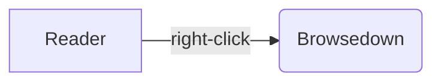
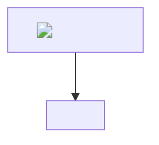

# Diagrams



A hostile diagram: its text must reach the page only as escaped code.



<pre><code class="language-mermaid">graph TD; Raw --> HTML</code></pre>

<figure class="bd-mermaid"><p>A document can't fake the wrapper.</p></figure>

```js
const stillHighlighted = true;
```
